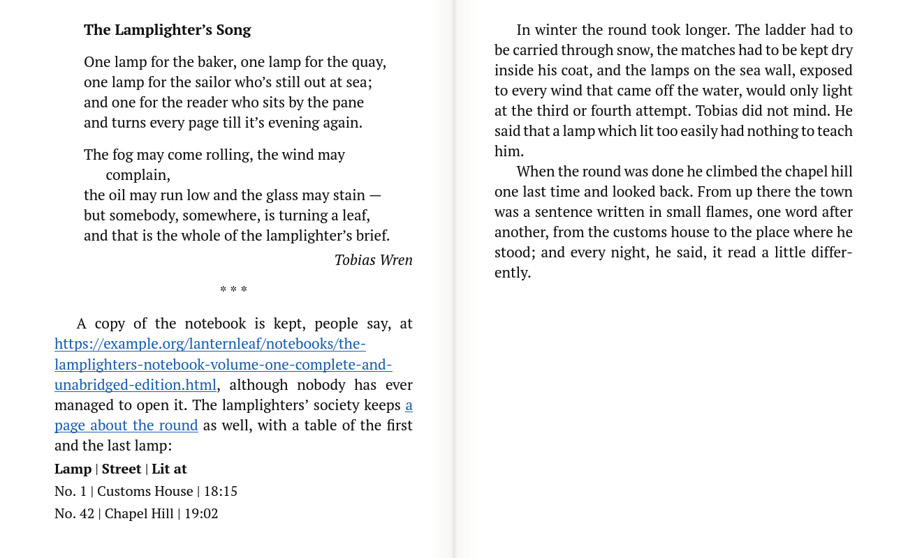
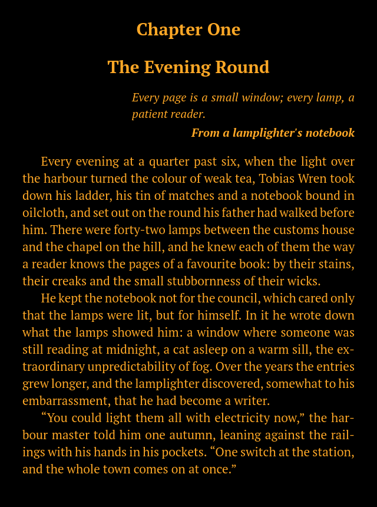
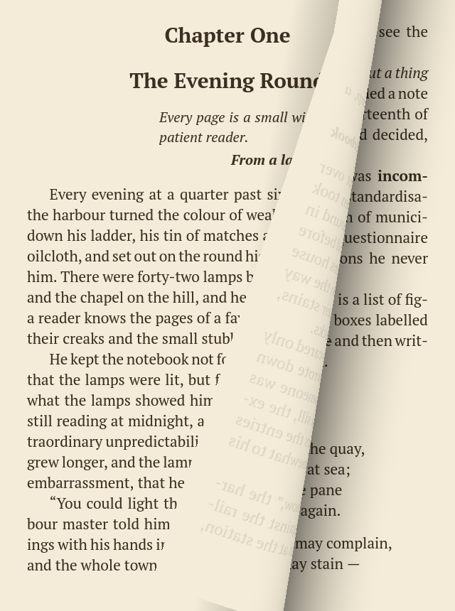
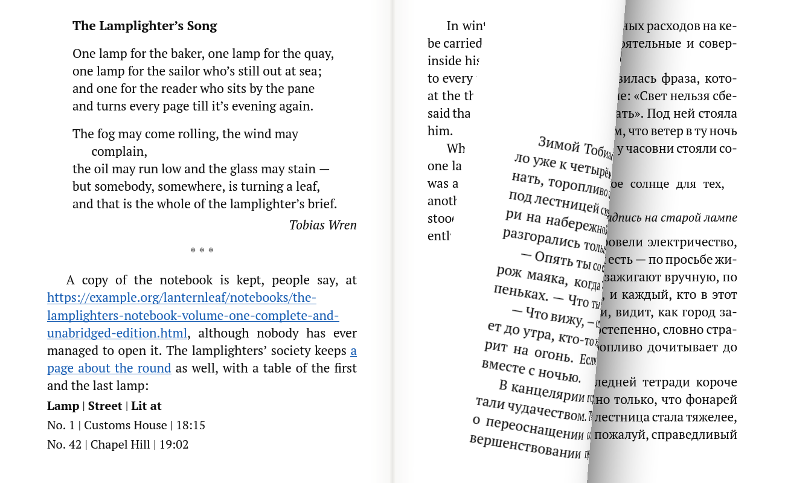

# Lanternleaf

A quiet book reader for **FB2** and **TXT**, drawn entirely on the GPU. It reflows text with TeX-quality line
breaking and hyphenation for English and Russian, turns pages with a 3D page curl, has science-based night
themes, and can dig books out of an unsorted *Downloads* folder by file name, title, author or a phrase from
the text.

ai folder contains full prompt with detailed spec description for any AI model you would like to use,
on any effort level, to generate application code and build it for platforms, technology and tools descibed below.
In new era of AI, I do not see any value to provide code itself, I believe that detailed promt is enough.
As an example I'm providing you metrics from Claude Code for code generation and build from final prompt:
Code genaration and build date: 2026-11-03, on Opus 5.5 at low effort.
┌──────────────────────────────────────────┬──────────────────────────────────────────────────────────────┐
│                  Metric                  │                            Value                             │
├──────────────────────────────────────────┼──────────────────────────────────────────────────────────────┤
│ From your prompt to the final report     │ 14 min 15 s (11:16:04 → 11:30:19 local)                      │
├──────────────────────────────────────────┼──────────────────────────────────────────────────────────────┤
│ Whole session open (including idle time) │ 43 min                                                       │
├──────────────────────────────────────────┼──────────────────────────────────────────────────────────────┤
│ Cost (API-equivalent)                    │ $11.50 (Opus $11.495, Haiku $0.006)                          │
├──────────────────────────────────────────┼──────────────────────────────────────────────────────────────┤
│ Model API time / tool run time           │ 28.4 min / 7.6 min (summed across parallel agents)           │
├──────────────────────────────────────────┼──────────────────────────────────────────────────────────────┤
│ Agents                                   │ 1 main thread + 12 subagents (up to 9 running at once)       │
├──────────────────────────────────────────┼──────────────────────────────────────────────────────────────┤
│ Model responses                          │ 145 (main 26, subagents 119)                                 │
├──────────────────────────────────────────┼──────────────────────────────────────────────────────────────┤
│ Tool calls                               │ 194 (main 20, subagents 174)                                 │
├──────────────────────────────────────────┼──────────────────────────────────────────────────────────────┤
│ Failed tool calls                        │ 2                                                            │
├──────────────────────────────────────────┼──────────────────────────────────────────────────────────────┤
│ Lines added / removed (Write and Edit)   │ 9,787 / 10                                                   │
├──────────────────────────────────────────┼──────────────────────────────────────────────────────────────┤
│ Output tokens                            │ 225k (plus 9k thinking)                                      │
├──────────────────────────────────────────┼──────────────────────────────────────────────────────────────┤
│ Input tokens                             │ 9.13M read from cache, 0.99M written to cache, 1.4k uncached │
└──────────────────────────────────────────┴──────────────────────────────────────────────────────────────┘

It runs on **Windows 11 x64** and **Android** (phones, tablets, Chromebooks) from one C++20 code base:
SDL3, a portable core, and shaders written for both OpenGL 4.1 core and OpenGL ES 3.0.

Version 0.6.0 · © 2026 Vitali Pinzari. Released under the MIT License (see [LICENSE](LICENSE)).

| Day, two pages | Night amber | 3D page curl | Two-page turn |
|---|---|---|---|
|  |  |  |  |

> **About the name:** "Lanternleaf" means a leaf (page) read by lantern light. A web search in November 2026
> found no book reader with this name; only similar names came up (*Leaf e-Reader*, *OpenLeaf*, the
> *Lantern* Bible app).

## Features

- **GPU text rendering.** Every glyph is a textured quad in an OpenGL scene. A FreeType glyph atlas uses
  light hinting and 4 sub-pixel positions, and HarfBuzz does shaping (kerning, ligatures, combining stress
  marks) with per-character font fallback. Pictures, video, backgrounds and other scripts can be added to the
  same pipeline later.
- **One page or an open book.** *1 page* / *2 pages* on the toolbar (B on the keyboard; under *Menu* when the toolbar is short of room)
  switches between a single page and two pages side by side with a spine. One page is the default;
  *Automatic* shows two pages when the window is wide. Book mode also works on a narrow screen as long as each
  page stays readable (about 18 characters a line); otherwise Lanternleaf says the screen is too narrow.
- **Four ways to turn a page** (*Settings → Page turning*):
  - **3D page curl:** the page is a mesh bent around a moving cylinder in a perspective camera, with
    lighting, a see-through paper back side and a cast shadow. In book mode the right page flips over the
    spine and lands carrying the next left page.
  - **Slide:** the page (both pages in book mode) slides away to the left when going forward, and to the
    right when going back.
  - **Fade out and in:** the old page fades to the bare paper, then the new one appears.
  - **Instant** (the default): no animation and no flicker. The next and previous pages are drawn ahead, in idle
    time, into textures, so a turn only puts a finished picture on screen.
- **Toolbar.** The same toolbar on every screen: it shows the buttons that fit, and whatever does not fit a phone
  (upright or sideways) or a narrow window is under **Menu** at its right end, together with *About*. The desktop
  window cannot be made smaller than 10 % of its monitor's width and height.
- **Menu and status bar.** The toolbar at the top and a status bar at the bottom come and go together (pointer at
  the top or bottom edge, a tap in the middle of the page on phones). The status bar shows the chapter, a progress
  bar with chapter marks, the page and the percentage, and each of them works: the chapter opens the contents, a
  click or drag on the bar jumps there, and the page number or the percentage can be typed in. While the bars show,
  the page is laid out between them, so they never cover the text; hidden, the text fills the whole screen.
- **Panels** (contents, settings, library, help ...) open one at a time in the top left corner of the page and
  cover half of it: the left half on a wide screen, the top half on a tall one.
- **Two formats:**
  - **FB2:** sections, titles, epigraphs, poems and stanzas, citations, subtitles, emphasis, strong,
    strikethrough, sup/sub, footnotes (click a note number to see it in a pop-up), cover and embedded
    pictures. The parser is tolerant of broken files. `.fb2.zip` archives (common in Russian libraries) open
    directly.
  - **TXT:** paragraphs are rebuilt from hard-wrapped, indented or blank-line separated text, and chapter
    headings (Chapter, Глава, Часть, roman numerals…) go into the contents. `--` and spaced hyphens become
    em dashes, and Project Gutenberg boilerplate and `_italic_` markup are handled.
- **Zoom with reflow.** Ctrl + mouse wheel, Ctrl +/-, or a two-finger pinch. Text reflows around the reading
  position: the line you were reading stays on screen, and the same applies to window resizing.
- **Hyphenation and line breaking.** Lines are broken with the Knuth–Plass "total fit" algorithm (TeX) and
  hyphenated with Liang's algorithm using the TeX `hyph-utf8` patterns for American English and Russian. A
  greedy fallback and emergency splitting handle URLs and other unbreakable strings. Russian typographic
  rules apply: a dash never starts a line, and a dialogue dash stays with its first word.
- **Colour themes:**
  - Day (black on white)
  - Sepia
  - Dusk (warm, almost no blue)
  - Night amber (~600 nm)
  - Night red (>610 nm, keeps eyes dark-adapted)

  A brightness slider dims the text or the paper, and an optional clock-based day/night switch is
  available. Themes colour the text only:
  - Pictures always keep their own colours.
  - Web addresses are always blue and underlined, and open in the browser. That includes addresses written as
    plain text, such as the Project Gutenberg licence.

  See [the science notes](#why-these-night-themes) below.
- **Start where you left off.** The last book reopens at the same place, together with the window, the font
  and the theme. Positions are stored per book with a content fingerprint, so a book that was renamed or
  moved still resumes.
- **Finding books on disk** (Ctrl+F) searches chosen folders or all drives in the background, with results
  streaming in:
  - **File name:** includes transliteration, so *Толстой*, *Tolstoy* and *Tolstoj* all find
    `Tolstoy_Voyna-i-mir.fb2.zip`.
  - **Title, author, series:** read from FB2 metadata and cached, so repeated searches are instant.
  - **Text inside books:** finds a whole phrase, ignoring case, *ё/е* and typographic quotes.
  - **Empty query:** lists every book found, which is useful for sorting out a Downloads mess.

  System folders, licence and readme files, and OneDrive online-only placeholders are skipped.
- **Encodings and languages.** UTF-8, UTF-16 and the Russian legacy encodings Windows-1251, KOI8-R, CP866 and
  ISO-8859-5 are detected automatically by letter-frequency analysis; the FB2 XML declaration is honoured,
  and a wrong declaration is detected. English and Russian are fully supported. Other Latin and Cyrillic
  languages render correctly but are not hyphenated.
- **Also included:**
  - Table of contents
  - Find in the current book, with highlighting
  - Go to a page or percentage
  - Page numbers counted in the background while the status bar shows
  - Click or tap outside a menu or panel to close it and return to the page
  - Full screen
  - Recent books list
  - Drag and drop, file association friendly (`Lanternleaf.exe book.fb2`)
  - Idle CPU use is zero: the loop sleeps until something happens

## Building

Requires **Visual Studio 2026** with the *Desktop development with C++* workload. It already contains MSVC,
CMake, Ninja and vcpkg; nothing else needs to be installed.

```powershell
./build.ps1            # Release build. The first run builds the dependencies with vcpkg (about 7 min).
./build.ps1 -Test      # build and run the unit tests
./build.ps1 -Run       # build and start the reader
./build.ps1 -Config Debug
```

### Release folder

Every Release build, however it is started (`build.ps1`, Visual Studio or plain CMake), is also copied into
`release/<Platform>/`, ready to run or ship. File names carry the version:

```
release/
  Windows/   Lanternleaf-0.2.0.exe, assets/, msvcp140.dll, vcruntime140.dll, vcruntime140_1.dll,
             THIRD-PARTY-NOTICES.txt
  Android/   Lanternleaf-0.2.0.apk
```

**Version.** The single source is the `VERSION` file in the repository root. CMake and Gradle read it. It
appears in:

- the release file names;
- the app's *About* panel (and *Help*);
- the Windows file properties (version, copyright);
- the Android version name, with the version code as major·10000 + minor·100 + patch.

Bump it for every release. Earlier versions stay in the release folders next to the new one.

The Windows folder is self-contained. Libraries are linked statically and the Visual C++ runtime DLLs are
placed next to the exe, so you can copy the folder to any 64-bit Windows 10/11 PC and run it. If the staged
app is running while you build, the folder is left unchanged and the build prints a warning; close the app and
build again. Debug builds are never staged. Turn staging off with `-DLL_STAGE_RELEASE=OFF`.

The build itself lives in `build\vs2026\<Config>\Lanternleaf.exe`, with `assets` next to it.

You can also open the folder in Visual Studio (*File → Open → Folder*) and pick the *Visual Studio 2026
(x64)* preset, or run `cmake --preset vs2026` yourself with `VCPKG_ROOT` pointing at a vcpkg installation.

Dependencies (vcpkg manifest, pinned baseline): SDL3, FreeType, HarfBuzz, Dear ImGui (SDL3 + OpenGL3
backends), glad, miniz, stb, nlohmann-json.

## Android

The same C++ code runs on Android 9+ (phones, tablets, Chromebooks): OpenGL ES 3.0 renderer, SDL3, and the
same layout, hyphenation, FB2/TXT parsers and library search.

```powershell
./build-android.ps1                 # -> release\Android\Lanternleaf-<version>.apk (arm64-v8a + x86_64, signed)
./build-android.ps1 -Install -Run   # ... and install + start it on a connected phone or emulator
```

The build needs:

- **Android Studio** for the SDK, NDK 28.2.13676358, CMake 3.22.1 and its bundled JDK.
- **Visual Studio 2026** for vcpkg.

The script finds both. You can also open the `android` folder in Android Studio once the script has written
`android/local.properties`.

**Signing:** release APKs are signed with `android/keystore/lanternleaf-release.jks`, and its passwords are
in `android/keystore.properties`. Both are excluded from version control. Back them up: updates of an
installed app must be signed with the same key. Without them, Gradle falls back to the debug key.

What is different on a phone:

| | |
|---|---|
| Turn pages | tap the right part / left third of the page, or swipe |
| Bigger / smaller text | two-finger pinch (reflows, keeps your place) or A+ / A- |
| Menu and status bar | tap the middle of the page; buttons that do not fit the toolbar are under **Menu** at its right end; any tap on the page outside them hides them again |
| Screen brightness | swipe up or down on the left part of the page (Lanternleaf's own brightness; *Settings → Screen* has the slider and *Use the system brightness*) |
| One page / book | the **1 page** / **2 pages** buttons, or **Menu → One page** / **Two pages, like a book** when they do not fit |
| Panels | open in the top left half of the page over the dimmed page and stay in place; tap the page beside them (or Back) to return to reading |
| Back button | closes the open panel; on the page it leaves the app (the position is saved) |
| Finding books | **Find books** searches Download, Documents, Books and Telegram folders, or the whole device and SD cards. Android 11+ asks once for *All files access*, needed to read books outside the app's own folder |
| Opening books | **Open a book** browses folders; FB2/TXT/ZIP files can also be opened *with Lanternleaf* from file managers and messengers |
| Screen | immersive full screen and kept on while reading (both in Settings); text and buttons stay clear of the camera notch; turned sideways, two pages side by side |
| Keyboard | search fields get no auto-capitalisation or autocorrect flags; the page number field gets a number pad |

**If no books show up** (*Open a book* lists only folders, *Find books* finds "0 files"): Android hides
other apps' files from Lanternleaf until it has **All files access**.

1. On the first start Lanternleaf asks for it; the notices in *Find books* and *Open a book* have the same
   **Allow access** button.
2. Switch on *Allow access to manage all files* and come back. The list and the last search refresh on their
   own.
3. If the switch is greyed out (Android 13+ restricts some settings for apps installed from an APK file): go
   to *Settings → Apps → Lanternleaf → ⋮ → Allow restricted settings* and try again.

You can check the state in *Menu → About Lanternleaf*.

## Using it

| What | How |
|---|---|
| Next / previous page | → ↓ PgDn Space, mouse wheel, click the right part of the page / ← ↑ PgUp Shift+Space Backspace, click the left third |
| First / last page | Home / End |
| Bigger / smaller text | Ctrl + wheel, Ctrl+Plus / Ctrl+Minus, pinch; Ctrl+0 resets |
| Open a book | Ctrl+O or drag a file onto the window |
| Find books on disk / in this book | Ctrl+F / Ctrl+Shift+F |
| Recent books | Ctrl+L |
| Contents, Go to, Settings, Help | T, Ctrl+G, Ctrl+Comma, F1 |
| Colour theme | C / Shift+C, Ctrl+1 … Ctrl+5 |
| Toolbar and status bar | move the pointer to the top or bottom edge; right click or F10 pins them |
| Status bar | click the chapter (contents), the bar (jump, or drag), the page number or percentage (type one in) |
| Full screen | F11 or Alt+Enter |
| Footnote | click the note number |

Settings, reading positions, the search cache and a log file are stored in `%APPDATA%\Lanternleaf\`.

## Why these night themes

- **Day and Sepia.** Dark text on a light page (positive polarity) gives the best legibility in a lit room
  (Piepenbrock et al., *Ergonomics* 2013).
- **Why blue light matters at night.** Short-wavelength light, around 460–480 nm, suppresses melatonin most
  strongly, through the melanopsin cells of the retina (Brainard et al., *J Neurosci* 2001; Thapan et al.,
  *J Physiol* 2001). Reading on a light-emitting e-reader before bed delays sleep and circadian timing, and
  lowers next-morning alertness (Chang et al., *PNAS* 2015).
- **Dusk** keeps a warm, low-contrast palette with almost no blue for the evening.
- **Night amber** emits only long-wavelength light (~600 nm). Blocking blue with amber filters improved
  sleep in a randomised trial (Burkhart & Phelps, *Chronobiol Int* 2009).
- **Night red** stays above ~610 nm, where rods are almost blind, so your eyes remain dark-adapted. This is
  the reason astronomers, pilots and ship crews use red light at night. Combine it with the Brightness
  slider.

## Architecture

```
src/core      portable C++20, no SDL/GL: document model, FB2 and TXT parsers, encodings, zip,
              Liang hyphenation, Knuth–Plass line breaking, library search and metadata cache
src/text      FreeType + HarfBuzz: fonts, shaping cache, paragraph and page layout (BookLayout)
src/render    OpenGL 4.1 core / ES 3.0: glyph atlas, batched 2D renderer, 3D page turn
src/app       SDL3 application (main callbacks), settings, themes, Dear ImGui panels
src/platform  OS specifics: folders, drives, system fonts, cloud placeholders
tests         unit tests for the core and the layout engine (751 checks)
assets        PT Serif / PT Sans (OFL) and the hyphenation patterns
tools         make_icon.py (generates the application icon)
cmake         StageRelease.cmake (copies each Release build to release/<Platform>)
release       ready-to-run builds per platform (generated by the build)
```

Key design decisions:

- **Shaping is resolution independent.** Words are shaped once into em units and cached, so changing the font
  size only re-breaks lines and never reshapes text.
- **The reading position is a position in the text,** (paragraph, byte offset), not a page number. Pages are
  built on demand forwards or backwards from any line, so a zoom on a 3 MB book shows the new page in about
  1 ms. Page numbers come from a background pass that paginates the whole book in small time slices (about
  0.4 s of work for 1600 pages).
- **Going backwards matches going forwards.** At chapter starts the previous chapter is paginated forwards
  from its beginning, so going back shows exactly the pages you saw.

### How the Android build is put together

- **App model:** `android/` is a Gradle project, Android Gradle Plugin 9.3 with SDK 36. Its Java side is
  SDL3's glue (`org.libsdl.app`, from SDL 3.4.18) plus `LanternleafActivity`, which handles "Open with"
  intents (`content://` books are copied into app storage so they can be reopened after a restart), the
  *All files access* permission and the list of storage volumes. Native code calls these through JNI from
  `src/platform/Platform.cpp`.
- **Safe area:** `LanternleafSurface` reports only what covers content, the system bars and the camera
  cutout. SDL's own safe area also excludes the 30 dp back-gesture zones at both edges.
- **Native code:** Gradle builds the same root `CMakeLists.txt` with the SDK's CMake 3.22 into `libmain.so`.
  SDL3 is linked statically in its entirety, including its JNI entry points. Dependencies come from vcpkg
  (`arm64-android` and `x64-android`, with one install tree per ABI under `build/vcpkg_android/`).
  vcpkg cannot cross-build HarfBuzz for Android on a Windows host (its Meson build rejects Windows
  paths), so on Android HarfBuzz 14.6.0 is compiled from its official single-file `harfbuzz.cc`, pinned by
  SHA-256 (`cmake/HarfBuzzAmalgamated.cmake`).
- **Graphics:** shaders use the GLSL 4.10 / ES 3.00 common subset, and `render/Gl.h` switches to
  `<GLES3/gl3.h>`, so no glad is needed on Android.
- **Assets** are packaged from the shared `assets` folder and loaded with `SDL_LoadFile`.
- **Touch input:** gestures come from SDL finger events: tap zones, swipes and two-finger pinch.
  Touch-synthesised mouse clicks are ignored for page turning. Dear ImGui gets finger scrolling, and a
  scrolling drag never activates the item it ends on.

## Testing

- `ll_tests` covers the core and the layout engine:
  - UTF-8 and case folding
  - Encoding detection (cp1251, KOI8-R, CP866, UTF-16, cp1252)
  - The tolerant XML reader
  - FB2: structure, styles, footnotes, cover, broken markup
  - TXT paragraph heuristics and typography
  - Hyphenation
  - Line breaking
  - Transliteration matching
  - Library search on a temporary folder tree, including zip
  - Layout:
    - no overflow, justified edges;
    - pagination forwards and backwards, page counting;
    - zoom anchoring, unbreakable URLs;
    - headings taller than a page, and headings never ending a page.
  - Web addresses found in plain text: trailing punctuation and brackets, Cyrillic paths, existing links left
    alone, styles kept around the new link.
- **Screenshot mode** renders off-screen and writes a PNG. It is used for visual checks and never touches your
  settings unless `--allow-save` is given:

```powershell
Lanternleaf.exe --settings-dir <dir> --screenshot out.png --size 1280x820 [--theme night-amber]
  [--font-size 24] [--columns auto|1|2] [--page-turn curl|slide|fade|none] [--goto 37] [--next 3] [--turn 0.4]
  [--panel toc|settings|help|about|library|goto|browser|folders|storage]
  [--search "query" --search-root <dir> [--search-content]] [--find "phrase" [--find-go]]
  [--click x,y ...] [--allow-save] book.fb2
```

`--click x,y` (repeatable) sends a left click at window coordinates through the normal event path, one step
per frame: move, press, release. It is used to check that a click outside a menu or panel closes it.

- **Log:** `lanternleaf.log` in the settings folder. On quitting it also says how many Instant page turns were
  served from the pages prepared ahead.

## Known limitations

- Right-to-left and vertical scripts are shaped but not laid out right to left.
- Pictures placed inside a running paragraph are skipped; block pictures and the cover are shown.
- FB2 tables are simplified to rows with `|` separators.
- There is no text selection, copying, bookmarks or annotations yet.

## Credits and licences

**Lanternleaf** © 2026 Vitali Pinzari (developer). Released under the MIT License (see [LICENSE](LICENSE)). The app's *About* panel shows the
version, the credits and the full licence texts of the components below
(`assets/licenses/THIRD-PARTY-NOTICES.txt`).

- **Fonts:** PT Serif and PT Sans by ParaType, under the SIL Open Font License (`assets/fonts/OFL-*.txt`).
- **Hyphenation patterns** from [hyph-utf8](https://github.com/hyphenation/tex-hyphen):
  - American English by Gerard D.C. Kuiken (permissive notice)
  - Russian by Alexander I. Lebedev (LPPL 1.2+)

  See `assets/hyphenation/README.md`.
- **Libraries:** SDL3 (zlib), FreeType (FTL), HarfBuzz (MIT), Dear ImGui (MIT), glad (MIT), miniz (MIT),
  stb (public domain / MIT), nlohmann-json (MIT).
